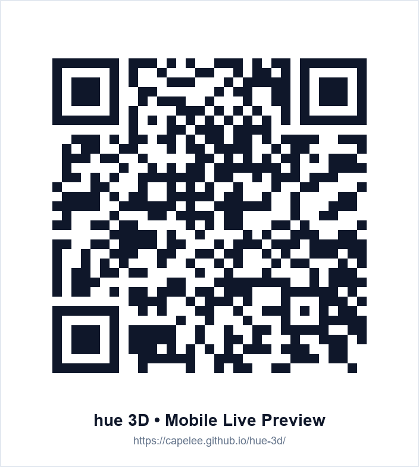

# hue 概念專輯 · 3D 結構打樣互動模組 (3D Album Interactive Mockup)

> **專案線上展示網址 (Live Demo)**: [https://capelee.github.io/hue-3d/](https://capelee.github.io/hue-3d/)  
> **專案原始碼倉庫 (GitHub Repository)**: [https://github.com/capelee/hue-3d](https://github.com/capelee/hue-3d)

---

## 📱 手機掃碼即刻體驗 (Mobile Live Preview)

使用 iPhone 或 Android 手機相機掃描下方 QR Code，即可在手機瀏覽器中直接享受極致簡約全螢幕手勢與體感光柵效果：

<div align="center">
  
  <p><b>掃描上方 QR Code 或直接訪問：<a href="https://capelee.github.io/hue-3d/">https://capelee.github.io/hue-3d/</a></b></p>
</div>

---

## 🚀 如何啟用 GitHub Pages 線上網站（30 秒完成）

若要在您的 GitHub 倉庫正式發佈線上網站，只需依照以下步驟開啟：

1. 前往倉庫設定頁面：[https://github.com/capelee/hue-3d/settings/pages](https://github.com/capelee/hue-3d/settings/pages)
2. 在 **Build and deployment** 區塊：
   - **Source**: 選擇 `Deploy from a branch`
   - **Branch**: 選擇 `main` 分支，資料夾選擇 `/ (root)`
3. 點選 **Save** 儲存。
4. 約等待 1~2 分鐘建置完成，即可在 [https://capelee.github.io/hue-3d/](https://capelee.github.io/hue-3d/) 瀏覽完整 3D 互動網站！

---

## 💎 核心特色與技術亮點 (Key Features)

### 1. 壓克力抽拉外盒鑽石倒角高光 (Acrylic Diamond Bevel & Refractive Sheen)
- **鑽石拋光微倒角高光 (Bevel Chamfer Specular Glints)**：前後板外側邊緣微倒角幾何結構（0.68mm ~ 0.72mm），搭配自訂著色器 96 次方鏡面高光，隨視角流轉呈現真實壓克力的攝影棚柔光箱亮線。
- **內壁折射微透水潤感 (Inner Cavity Translucency)**：雙面物理光學渲染（`side: THREE.DoubleSide`），於拉出抽屜時自然映射微透折射光影，展現實體盒裝的透光深度。

### 2. 三相光柵體感光學 (3-Flip Lenticular Card & Tilt Gyroscope)
- **三相光學柱鏡著色器**：精準模擬 125 × 125mm 柱狀透鏡光柵的微米級線條深度，動態切換三階段 RGB 畫面（P1 藍灰、P2 純綠、P3 艷紅）。
- **陀螺儀體感連動 (Tilt-to-Lenticular)**：支援 iOS 13+ 與 Android 陀螺儀（`DeviceOrientationEvent`），左右微幅傾斜手機即平滑變換光柵畫面，具備人體工學零點補償與指數平滑濾波（Lerp Smoothing）。
- **桌面端專屬光柵視角儀 (Lenticular HUD)**：右下角圓弧儀表即時顯示當前觀察角與對應階段指針。

### 3. 行動端極致簡約全螢幕設計 (Mobile Pure Minimalist UI)
- **零 UI 遮擋全螢幕**：手機寬度自動隱藏頂部工具鈕、零件卡與 Dock 列，僅留頂部精緻品牌 Logo。
- **單一微型切換懸浮鈕 (44px FAB)**：底部置中單鍵循環切換視角，手勢操作順手不卡頓。
- **互動動態淡化**：觸控旋轉縮放模型時按鈕自動淡化至 18%，沉浸感倍增。

### 4. 七大多維結構展示模式 (7 Structural Presentation Modes)
1. **01. 標準成盒 (Assembled)**：精裝完整收納展示。
2. **02. 抽拉抽出 (Pullout)**：壓克力封套固定，抽出內層抽屜與歌詞卡本。
3. **03. 多層展開 (Unfold)**：PET 封面如蝴蝶般展開，漸層光柵卡層層亮相。
4. **04. 立體軸向炸開 (Exploded)**：各組件沿三維空間軸線炸裂，盡覽內部結構。
5. **05. 水平展開 (Exploded Horizontal)**：橫向一字形陳列展示。
6. **06. 立體展架 (PET Fold)**：PET 封面立體展示模式。
7. **07. 俯視平鋪 (Knolling)**：全組件以 90 度俯角整齊平鋪陳列，方便整體印刷檢視。

---

## 🛠️ 本地端執行方式 (Local Development)

本專案採用單一完整 HTML 封裝（所有 3D 模型資料與著色器皆內嵌優化），無需複雜建置流程：

```bash
# 複製倉庫
git clone https://github.com/capelee/hue-3d.git
cd hue-3d

# 使用任意靜態伺服器開啟
npx serve .
# 或使用 Python
python -m http.server 8080
```

開啟瀏覽器前往 `http://localhost:8080` 即可預覽。

---

## 📄 授權條款 (License)

本專案視覺設計與 3D 結構專利歸屬 **hue 概念專輯** 製作團隊所有。
